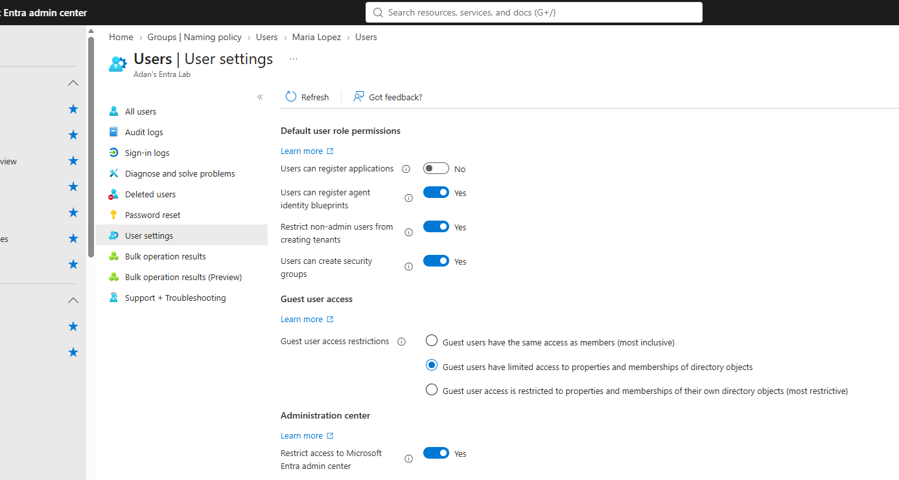

# Lab 02: Tenant Configuration (Domains, Branding, Properties, User Settings)

| | |
|---|---|
| **SC-300 domain** | D1: Implement and manage user identities |
| **Objective** | Configure tenant-wide settings |
| **License needed** | Entra ID Free (branding saved on Free in this tenant) |

## 1. Requirement
Configure tenant properties and branding, understand custom domain verification, and lock down default user capabilities following least privilege.

## 2. What I configured
1. **Tenant properties:** technical contact, privacy contact and **privacy statement URL** (shown to B2B guests).
2. **Access management for Azure resources (elevate access):** enabled it, confirmed it grants **User Access Administrator at root scope**, then **disabled it** again.
3. **Custom domain flow:** added a test domain, reviewed the **TXT (`MS=ms…`) verification record**, confirmed an **unverified domain isn't offered as a UPN suffix**, then deleted it.
4. **Company branding:** background color + sign-in page text.
5. **User settings:** Users can register applications = **No**; Restrict non-admin users from creating tenants = **Yes**; Restrict access to Microsoft Entra admin center = **Yes**.

## 3. Why this design
| Setting | Reason |
|---|---|
| Elevate access off after use | It's a very powerful role across every subscription. Least privilege: elevate only when needed. |
| App registration = No | Prevents unmanaged "shadow" app registrations; developers can get the **Application Developer** role instead |
| Restrict admin center | Hides the portal from non-admins. **Not a security boundary**: members can still read the directory through Graph. |

## 4. Verification
- Branding appeared **only after the username was entered** (that's when the tenant becomes known).
- A test non-admin user got "You don't have access" in the admin center.
- An unverified domain was not available for new usernames.

## 5. Screenshots
**Hardened default user settings:** users can't register applications, can't create tenants, and non-admins can't access the Entra admin center.

## 6. What I learned
- The initial `onmicrosoft.com` domain is permanent. Custom domains need a TXT or MX record. **Verify domains before syncing** on-prem users, or they fall back to `onmicrosoft.com` UPNs.
- **Entra roles and Azure RBAC roles are separate systems.** A Global Admin has no Azure resource rights until they elevate access.
- Tenant-wide toggles that sound like security ("restrict admin center") may only change the UI.
