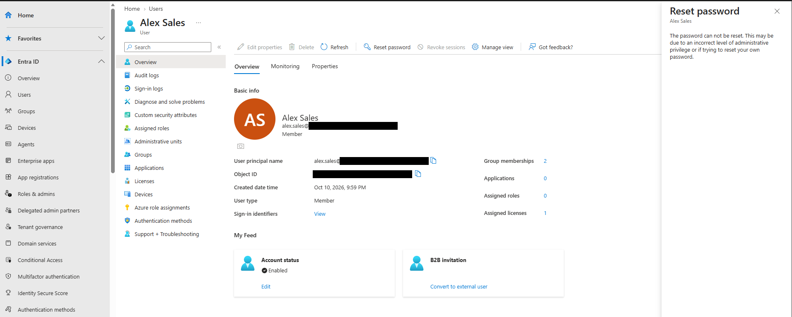
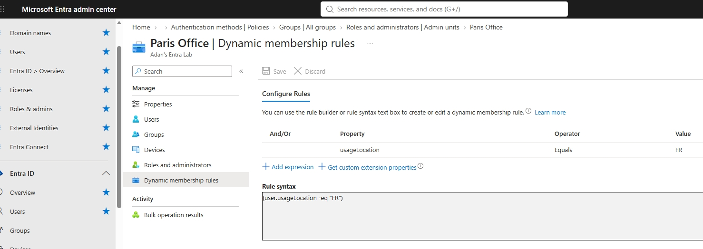
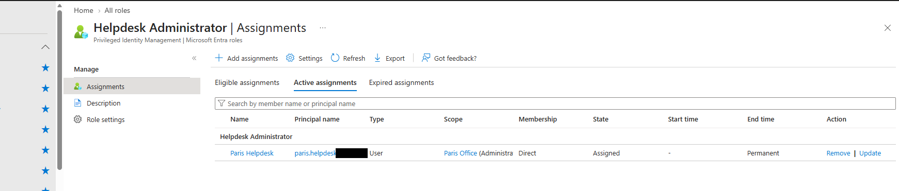
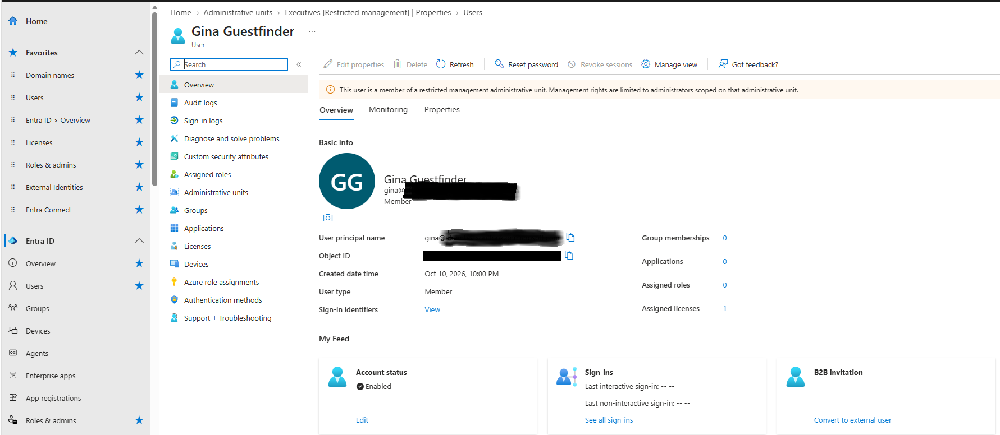
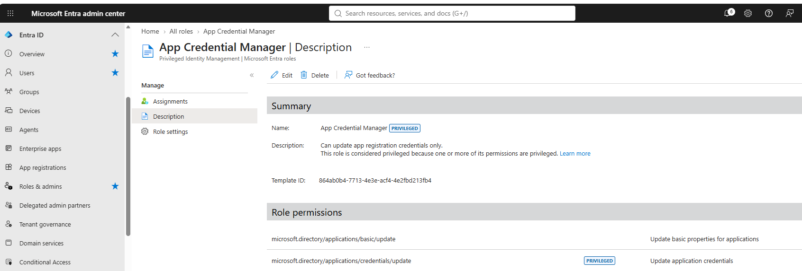

# Lab 04: Scoped Helpdesk Delegation with Administrative Units

| | |
|---|---|
| **SC-300 domain** | D1: Implement and manage user identities |
| **Objective** | Administrative units, scoped role assignments, restricted management, custom roles |
| **License needed** | Entra ID P1/P2 (P2 trial activated) |

## 1. Requirement
Paris helpdesk staff must reset passwords **only for Paris users**, new Paris users should be covered **automatically**, and executive accounts must be **protected even from tenant-wide admins**.

## 2. What I configured
1. Activated an **Entra ID P2 trial** and assigned licenses (in the Microsoft 365 admin center).
2. Created the **"Paris Office"** administrative unit with **dynamic user membership**:
   ```
   (user.usageLocation -eq "FR")
   ```
3. **Removed** the tenant-wide Helpdesk Administrator assignment and **re-assigned it scoped to the Paris Office AU**.
4. Created a **restricted management AU, "Executives"**, and added a test executive account.
5. Built a **custom role, "App Credential Manager"**, with `microsoft.directory/applications/credentials/update`.

## 3. Why this design
| Option | Decision |
|---|---|
| AU + Helpdesk Admin scoped to the AU | ✅ Smallest role + narrowest scope |
| Tenant-wide Helpdesk Admin | ❌ Can reset every regular user in the tenant |
| Conditional Access | ❌ Controls *how users sign in*, not *what admins can manage* |
| Dynamic AU membership | ✅ Joiners and movers are handled automatically |
| Restricted management AU | ✅ Blocks tenant-wide admins; only AU-scoped admins can modify members |

## 4. Verification
| Test | Before | After |
|---|---|---|
| Helpdesk scope (PowerShell `DirectoryScopeId`) | `/` | `/administrativeUnits/<id>` |
| Reset a Paris user | ✅ | ✅ |
| Reset a non-Paris user | ✅ (too much access) | ❌ (blocked, as intended) |
| Global Admin edits an executive in the restricted AU | — | ❌ Blocked |
| Turn off restricted management afterwards | — | ❌ Not allowed (set at creation only) |

## 5. Screenshots
**The scoped helpdesk user can't reset a user outside the Paris Office unit.** This is the least-privilege design working.


**The Paris Office unit fills itself automatically** from a dynamic rule on usage location.


**Helpdesk Administrator assigned with administrative-unit scope** (Paris Office), not tenant-wide.


**Restricted management unit:** the Executives unit protects its members, even from tenant-level admins.


**Custom role:** App Credential Manager, limited to updating app registration credentials.


## 6. What I learned
- An AU is a **scope**, not an OU: flat (no nesting), many AUs per user, no policies.
- Dynamic AUs hold **users OR devices**, never both.
- **Adding a group to an AU adds only the group object, not its members.**
- Global Administrator **can't** be scoped to an AU.
- A restricted management AU needs a **role scoped to it** for the team that manages those accounts.
- The custom role permission picker drops selections between searches; one broad search fixed it.
