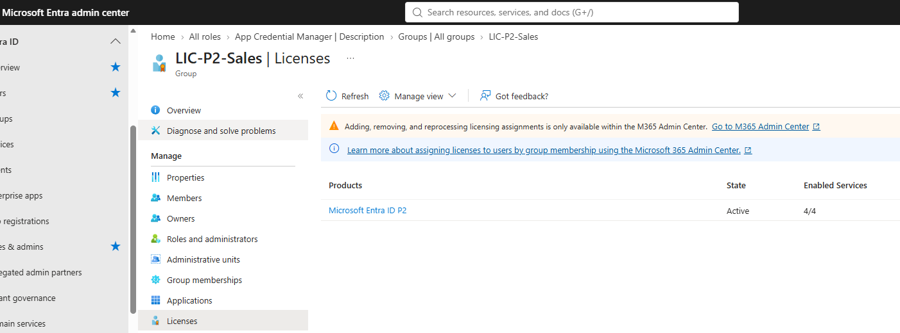
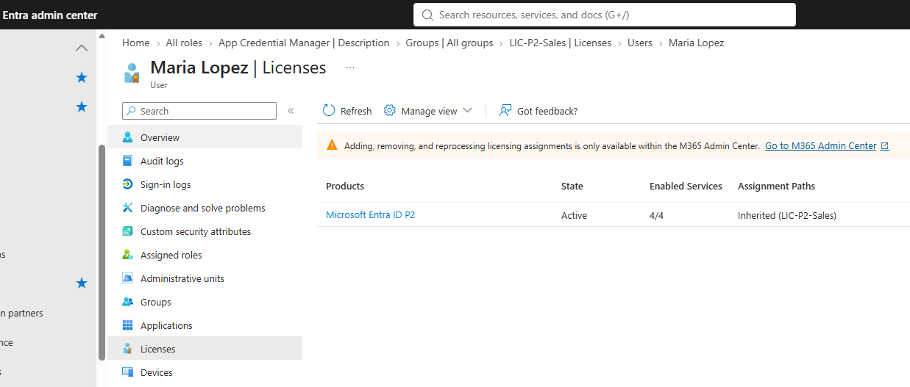
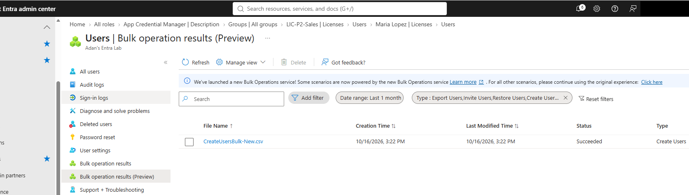
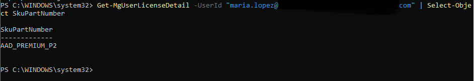

# Lab 05: User Lifecycle and Group-Based Licensing

| | |
|---|---|
| **SC-300 domain** | D1: Implement and manage user identities |
| **Objective** | Bulk user management, delete/restore, leaver process, group-based licensing |
| **License needed** | Entra ID P1 (group-based licensing) |

## 1. Requirement
Onboard several users at once, license a team automatically, handle a leaver securely, and recover from an accidental deletion without losing access configuration.

## 2. What I configured
1. **Bulk create** from the CSV template (3 users).
2. A security group `LIC-P2-Sales` with **group-based licensing** (Entra ID P2).
3. **Leaver process** on a test user: **block sign-in + revoke sessions**, then delete.
4. **Restored** the user from Deleted users.
5. Fixed user data with Graph PowerShell.

```powershell
Update-MgUser -UserId "tom.brown@contoso.onmicrosoft.com" -UsageLocation "US" -JobTitle "Sales Rep"
Update-MgUser -UserId "maria.lopez@contoso.onmicrosoft.com" -AccountEnabled:$true
Get-MgUserLicenseDetail -UserId "tom.brown@contoso.onmicrosoft.com" | Select-Object SkuPartNumber
```

## 3. Why this design
| Option | Decision |
|---|---|
| Bulk create (CSV) | ✅ Least effort for many cloud-only users |
| Group-based licensing | ✅ Licenses follow group membership: no manual assign/remove |
| Restore instead of recreate | ✅ Keeps the same object ID, groups, licenses and settings |
| Block sign-in + revoke sessions | ✅ Stops new sign-ins *and* ends existing sessions |

## 4. Verification and troubleshooting
- **The first bulk job failed.** The FailureReason column showed: (1) the template's example row used an **unverified domain**; (2) passwords were rejected by **complexity / banned-password** checks. Fixed both and re-ran successfully.
- A new user with usage location FR **automatically joined** the dynamic "Paris Office" AU from Lab 04.
- Group-based licensing: the license showed as **Inherited**. A user **without a usage location still got licensed** (fell back to the tenant country).
- After the restore: **same group membership, same license, and sign-in still blocked**, so the exact state came back.
- A post-import check with `Get-MgUser` found a **missing department** and a user **blocked by mistake** in the CSV; both fixed with `Update-MgUser`. The first query also showed **replication lag** (re-running a few minutes later returned the full results).

## 5. Screenshots
**Group-based licensing:** the Entra ID P2 license is assigned to the LIC-P2-Sales group.


**The user inherits the license from the group,** so no per-user assignment is needed.


**Bulk create from CSV** completed successfully.


**Verified with Microsoft Graph PowerShell.**


## 6. What I learned
- Soft delete lasts **30 days**. A **synced** user must be restored **on-prem** (AD Recycle Bin), because the source of authority wins.
- Direct and inherited licenses are **independent**. A license shortage gives a **partial assignment + errors**.
- Group-based licensing works with security groups and security-enabled M365 groups (not distribution lists) and **doesn't follow nested groups**.
- Always **verify a bulk import** afterwards.
