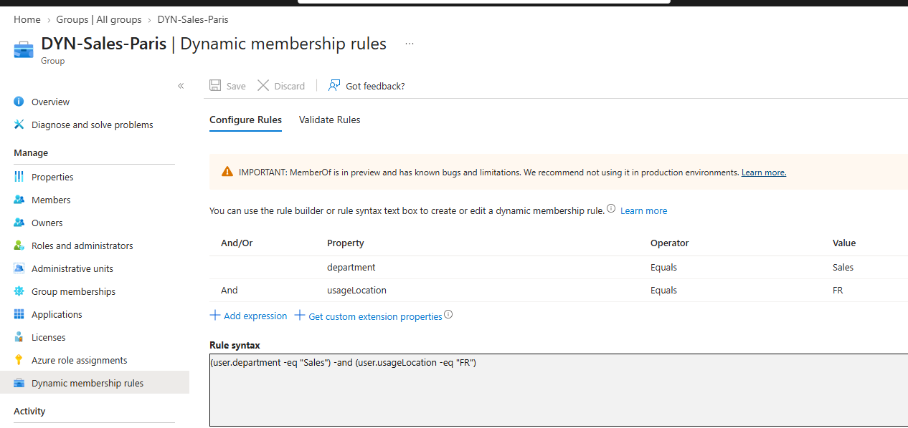
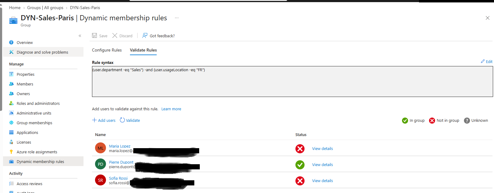
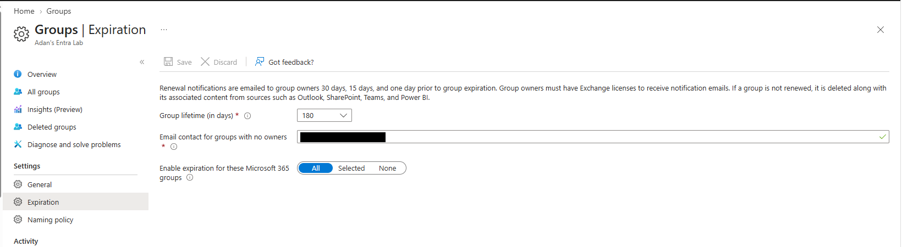

# Lab 06: Dynamic Groups, Naming and Expiration Policies

| | |
|---|---|
| **SC-300 domain** | D1: Implement and manage user identities |
| **Objective** | Create and manage groups; dynamic membership; group governance |
| **License needed** | Entra ID P1 |

## 1. Requirement
Group membership should follow HR attributes automatically (joiners and movers), and Microsoft 365 groups should follow naming and lifecycle standards.

## 2. What I configured
1. A dynamic security group `DYN-Sales`:
   ```
   (user.department -eq "Sales")
   ```
2. A compound-rule group `DYN-Sales-Paris`:
   ```
   (user.department -eq "Sales") -and (user.usageLocation -eq "FR")
   ```
3. A **naming policy** (prefix `GRP-`, blocked word `CEO`) and an **expiration policy** (180 days) for Microsoft 365 groups.
4. Deleted and restored an M365 group and a security group.

## 3. Why this design
| Option | Decision |
|---|---|
| Dynamic security group | ✅ Membership maintains itself; pairs with group-based licensing |
| Assigned group | ❌ Manual upkeep for every joiner and mover |
| `-and` compound rule | ✅ Only users meeting **both** conditions |
| Naming + expiration policies | ✅ Consistent names; unused groups clean themselves up |

## 4. Verification
- **Validate Rules** tested users before saving: the matching users ✅, a Marketing user ❌.
- Membership filled in after a short **processing delay**.
- Changing a user's department to Sales → **joined automatically**; changing it back → **removed automatically**.
- **Manual removal from the dynamic group was blocked.**
- Compound rule: only the user in **Sales *and* France** matched (one user failed on location, another on department).
- The naming prefix **wasn't applied** to a group created by a Global Admin (**admins are exempt**).
- Both deleted groups appeared in **Deleted groups**, so **security group soft delete is now available** (historically only M365 groups were restorable).

## 5. Screenshots
**Compound dynamic rule:** department = Sales **and** usage location = FR.


**Rule tested before relying on it:** only Pierre (Sales + France) matches. Maria and Sofia each fail one condition.


**Group lifecycle:** Microsoft 365 groups expire after 180 days unless they're renewed.


## 6. What I learned
- Security groups can contain devices and nested groups; M365 groups contain **users only**.
- One dynamic group = **users OR devices**.
- **`-and` = one person meets both conditions; `-or` / `-in` = either.** "Sales and Marketing people" is an `-or` rule.
- Converting assigned → dynamic **replaces** the members.
- Naming and expiration policies apply to **M365 groups only**. Expired M365 groups can be **restored within 30 days**.
